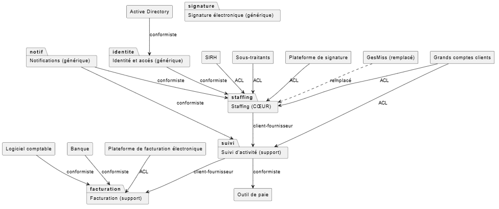
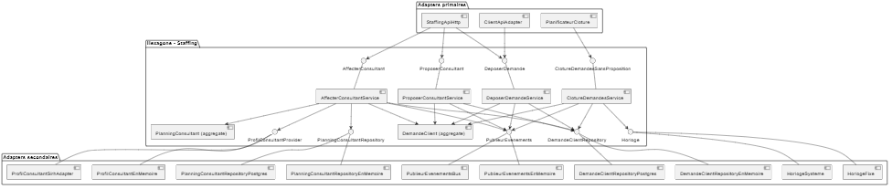
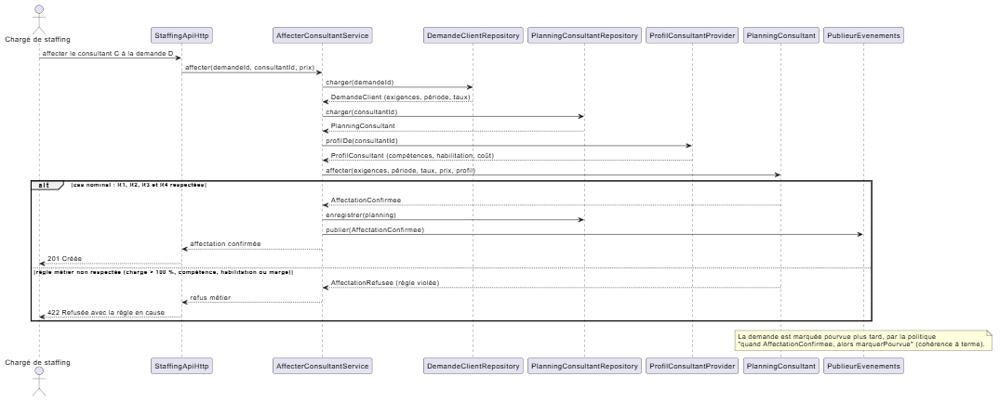

# Document d'architecture technique - Nexus360 - Elias PARCET

| | |
|---|---|
| Mission fil rouge | D01 - Concevoir l'architecture logicielle cible |
| Équipe | Elias PARCET |
| Version | 1.0 - 2026-11-24     |
| Gabarit | dat-gabarit 2.0 |
| Dépôt | https://github.com/TortueBurger/nexus360 |

## 0. Usage de l'IA (Q3, obligatoire)

| Outil | Pour quoi faire | Sections concernées | Ce que nous avons vérifié ou corrigé |
|---|---|---|---|
| Claude Code (Anthropic) | Mise en place de l'arborescence, premier brouillon des sections 1 à 11 et des trois diagrammes à partir du sujet, de son annexe et du livret | 1 à 11, diagrammes | Tout ce qui a été écrit par IA, ainsi que les diagrammes ont été relus et revus. |


## 1. Contexte et périmètre

- Le portail Nexus360 en trois phrases, avec les mots de l'expert métier : Nexus360 est une ESN qui vend à des entreprises clientes le travail de ses consultants et de ses sous-traitants. Le portail suit tout le cycle d'une mission : demande du client, proposition de consultants, affectation, saisie puis validation du CRA mensuel, facture, et paiement du sous-traitant. Il remplace l'application historique GesMiss. Ce qui fait gagner Nexus360 est le staffing : proposer vite le bon consultant (objectifs : proposition sous 48 h, moins de 5 % de consultants en intercontrat).
- Les utilisateurs (internes, télétravailleurs, partenaires) et ce qu'ils font : consultants (~380, saisie du CRA souvent sur mobile), chargés de staffing (~10, proposent et affectent), commerciaux (~15, fixent le prix journalier vendu), managers (~30), comptabilité (~5, facturation et paiements), clients (~120 entreprises, déposent des demandes et valident les CRA), sous-traitants (~60 sociétés, 90 intervenants).
- Les systèmes existants et les partenaires avec lesquels le portail échange : GesMiss (remplacé), SIRH (conservé, lu), logiciel comptable, Active Directory, outil de paie ; grands comptes clients (API), sous-traitants, plateforme de signature électronique, plateforme agréée de facturation électronique, banque.
- Ce que couvre ce DAT, et ce qu'il ne couvre pas : l'architecture logicielle cible d'un monolithe modulaire (un dossier par bounded context, un hexagone par contexte cœur). Hors périmètre : modèle de données (MCD/MLD, mission D02), microservices (mission D08), infrastructure.
- Hypothèses : ce que l'expert n'a pas dit et que nous avons supposé (format du sujet, partie 9).

**H1** - Nous supposons qu'un CRA non validé par le client sous 5 jours ouvrés **n'est pas validé d'office** : la facture reste bloquée et le commercial relance.
Pourquoi : R8 interdit de facturer un CRA non validé ; une validation d'office contredirait sa lecture stricte.
Si c'est faux : le contexte Suivi d'activité gagne une politique « quand 5 jours sans réponse, alors valider d'office » et un événement `CRAValideDOffice`.

**H2** - Nous supposons qu'une **proposition ne bloque pas** le consultant : seule une affectation consomme de la charge.
Pourquoi : R1 parle de charge cumulée d'affectations ; l'annexe ne dit pas qu'une proposition réserve quoi que ce soit, et plusieurs propositions par demande sont admises.
Si c'est faux : la proposition devient une réservation temporaire dans `PlanningConsultant` (nouvel invariant, durée de blocage à définir) : voir ADR-001.

**H3** - Nous supposons que les sous-traitants utilisent **le même modèle** que les salariés, avec un adapter primaire dédié (espace séparé côté interface seulement).
Pourquoi : les règles R1 à R9 sont les mêmes pour un intervenant sous-traitant, seul le paiement (R9) diffère.
Si c'est faux : un contexte « Sous-traitance » distinct devrait être créé.

**H4** - Nous supposons que les **absences** des consultants sont **hors périmètre** de Staffing : elles ne réduisent pas la charge R1.
Pourquoi : l'annexe cite les absences comme non tranchées et ne leur donne aucune règle.
Si c'est faux : un VO `Indisponibilite` entre dans `PlanningConsultant`.

**H5** - Nous supposons que le **coût journalier** du consultant est lu dans le SIRH au moment de l'affectation et **figé** dans l'affectation.
Pourquoi : R4 compare le prix vendu au coût ; un coût qui change plus tard ne doit pas invalider une affectation confirmée.
Si c'est faux : le coût serait relu à chaque contrôle et R4 deviendrait une règle de lecture.

**H6** - Nous supposons que la **Mission** n'est pas un aggregate : c'est une demande pourvue, repérée par `DemandeId` + `AffectationId`.
Pourquoi : aucune règle de l'annexe ne porte sur la mission elle-même, seulement sur la demande et l'affectation.
Si c'est faux : un aggregate `Mission` devra porter son cycle de vie.

## Traçabilité trk-4cy6s

Gabarit utilisé pour ce DAT : **dat-gabarit 2.0**.

## 2. Glossaire - langage ubiquitaire (D1)

| Terme | Définition (mots de l'expert) | Contexte |
|---|---|---|
| Demande client | Besoin déposé par un client : compétences attendues (avec niveau, certaines obligatoires), date de début, durée, taux d'occupation, lieu, mission sensible ou non | Staffing |
| Proposition | Consultant (salarié ou intervenant sous-traitant) soumis au client pour une demande ; Envoyée, puis Retenue ou Écartée | Staffing |
| Affectation | Lien entre un consultant et une demande, sur une période et à un taux d'occupation ; Confirmée, En cours, Terminée ou Annulée | Staffing |
| Consultant | Salarié ou intervenant d'un sous-traitant dont Nexus360 vend le travail | Staffing, Suivi d'activité |
| Charge | Somme des taux d'occupation des affectations d'un consultant sur une période ; jamais plus de 100 % (R1) | Staffing |
| Compétence / niveau | Ce qu'un consultant sait faire et à quel niveau ; obligatoire ou non dans une demande (R2) | Staffing |
| Habilitation | Autorisation exigée pour une mission sensible, valide à la date de début (R3) | Staffing |
| Mission sensible | Mission pour une banque ou la défense | Staffing |
| Prix journalier vendu | Prix fixé par le commercial ; au moins coût journalier + 15 % sauf accord écrit du directeur commercial (R4) | Staffing |
| Intercontrat | État d'un consultant redevenu disponible après une affectation annulée | Staffing |
| Non pourvue | Demande clôturée faute de proposition au bout de 5 jours ouvrés (R5) | Staffing |
| CRA | Compte rendu d'activité : un par consultant, par mission et par mois (R6, R7) ; Brouillon, Soumis, Validé ou Refusé | Suivi d'activité |
| Jour ouvré | Jour travaillé du calendrier ; borne le CRA (R6) et la clôture d'une demande (R5) | Staffing, Suivi d'activité |
| Facture | Une par CRA validé ; Émise, Transmise, Payée (R8) | Facturation |
| Paiement du sous-traitant | Virement à 45 jours après la validation du CRA de son intervenant (R9) | Facturation |

Mots ambigus repérés et décision prise (un sens par contexte) :

- **Mission** : pour Staffing, c'est une demande pourvue (H6) ; pour un grand compte client c'est un « bon de commande » (traduit par l'ACL) ; pour Suivi d'activité c'est une simple référence `MissionRef` sur laquelle porte un CRA ; Facturation n'en connaît pas.
- **Consultant** : côté client c'est un « prestataire » (traduit par l'ACL) ; pour Staffing un consultant a un planning, pour Suivi d'activité il est l'auteur d'un CRA, pour Facturation il n'existe que comme sous-traitant à payer.
- **Validé** : un CRA est validé par le client ; une absence est validée par le manager (hors périmètre, H4). Dans ce DAT « validé » ne qualifie que le CRA.
- **Disponible** : en Staffing, un consultant est disponible sur une période si sa charge cumulée y est inférieure à 100 % (et non « sans mission »).

## 3. Sous-domaines et bounded contexts (D2)

| Contexte | Sous-domaine (cœur, support, générique) | Responsabilité (une phrase) | Ce qu'il ne fait pas |
|---|---|---|---|
| Staffing | **Cœur** | Faire correspondre les demandes des clients aux consultants et affecter le bon consultant, en respectant R1 à R5 | Ne saisit ni ne valide les CRA, ne facture, n'envoie pas d'emails |
| Suivi d'activité | Support | Gérer le CRA mensuel de bout en bout (saisie, soumission, validation ou refus par le client) selon R6 et R7 | Ne choisit pas qui travaille sur quoi, ne calcule pas de montant |
| Facturation | Support | Produire et suivre la facture d'un CRA validé et planifier le paiement des sous-traitants (R8, R9) | Ne valide pas de CRA, ne fixe pas les prix |
| Notifications | Générique | Prévenir les personnes par email et application mobile | Ne décide pas qui prévenir ni quand |
| Signature électronique | Générique | Faire signer le contrat de mission | Ne rédige pas le contrat |
| Identité et accès | Générique | Authentifier les utilisateurs (Active Directory) et ouvrir ou fermer les accès (compte, VPN) | Ne connaît aucune règle de staffing |

Context map : `diagrammes/context-map.puml`.



| Amont | Aval | Relation | Pourquoi |
|---|---|---|---|
| SIRH | Staffing | ACL | Le SIRH parle de fiches collaborateurs ; Staffing traduit en `ProfilConsultant` pour ne pas importer son modèle |
| Grands comptes clients | Staffing | ACL | Leur vocabulaire (« bon de commande », « prestataire ») n'est pas le nôtre |
| Sous-traitants | Staffing | ACL | Profils proposés dans leur format, traduits en `ProfilConsultant` |
| Staffing | Suivi d'activité | Client-fournisseur | Suivi d'activité a besoin des affectations (R7) ; Staffing les publie, Suivi d'activité exprime son besoin |
| Grands comptes clients | Suivi d'activité | ACL | Validation des CRA par l'API du client, dans son vocabulaire |
| Suivi d'activité | Facturation | Client-fournisseur | Facturation naît d'un `CRAValide` ; l'événement est le contrat |
| Suivi d'activité | Outil de paie | Conformiste | Le format de jours à envoyer est imposé par l'outil de paie |
| Plateforme de facturation électronique | Facturation | ACL | Son modèle (réglementaire) ne doit pas entrer dans notre domaine |
| Logiciel comptable | Facturation | Conformiste | Nous reprenons son format de réception des factures |
| Banque | Facturation | Conformiste | Format de virement imposé |
| Notifications | Staffing, Suivi d'activité | Conformiste | Produit générique, utilisé tel quel |
| Signature électronique | Staffing | ACL | API externe, traduite en `DemandeDeSignature` |
| Identité et accès (Active Directory) | tous | Conformiste | Comptes et authentification pris tels quels |

GesMiss est remplacé : il n'apparaît que dans la reprise de l'existant (section 11).

## 4. DDD ou pas, contexte par contexte (J1)

| Contexte | Approche (modèle riche DDD, couches, CRUD, produit du marché) | CQRS (oui / non) | Event Sourcing (oui / non) | Justification ou ADR |
|---|---|---|---|---|
| Staffing | Modèle riche DDD | Non | Non | Cœur de métier, règles R1 à R5 nombreuses et changeantes. Pas de CQRS : 40 demandes par mois, charge d'écriture et de lecture modestes. Pas d'Event Sourcing : aucun besoin d'audit rejouable exprimé. ADR-001 |
| Suivi d'activité | Couches (petit aggregate `CRA`) | Non | Non | Indispensable mais non différenciant ; règles R6 et R7 simples. La pointe de fin de mois se règle par la technique, pas par un modèle séparé |
| Facturation | Couches / CRUD | Non | Non | Une facture par CRA validé, avoirs hors périmètre : un enchaînement simple |
| Notifications | Produit du marché | Non | Non | Générique |
| Signature électronique | Produit du marché | Non | Non | Générique |
| Identité et accès | Produit du marché (Active Directory) | Non | Non | Générique |

## 5. Modèle des contextes cœur (D3)

### 5.1 Staffing

**Aggregate PlanningConsultant** - racine : `PlanningConsultant` (identité : `ConsultantId`)

- Entités : `Affectation` (identité `AffectationId`, statut Confirmée / En cours / Terminée / Annulée).
- Value objects (et la règle que chacun porte) : `ConsultantId` (identifiant non vide) ; `Periode` (début avant ou égal à fin) ; `TauxOccupation` (de 1 à 100 %) ; `NiveauCompetence` (ordonné, comparable) ; `PrixJournalier` (montant strictement positif) ; `CoutJournalier` (idem) ; `ProfilConsultant` (compétences, habilitation, coût lus du SIRH, immuable) ; `ExigencesMission` (compétences requises avec niveau et caractère obligatoire, sensible ou non).
- Autres aggregates référencés par leur id : `DemandeClient` (par `DemandeId`).

| # | Invariant (règle toujours vraie) | Méthode de la racine qui la vérifie |
|---|---|---|
| 1 | La charge cumulée d'un consultant ne dépasse jamais 100 % sur une même période (R1) | `PlanningConsultant.affecter()` |
| 2 | Une affectation exige toutes les compétences obligatoires, au niveau demandé ou au-dessus (R2) | `PlanningConsultant.affecter()` |
| 3 | Une mission sensible exige une habilitation valide à la date de début (R3) | `PlanningConsultant.affecter()` |
| 4 | Le prix journalier vendu n'est pas inférieur au coût + 15 %, sauf accord écrit du directeur commercial (R4) | `PlanningConsultant.affecter()` |
| 5 | Une affectation ne revient jamais à un statut précédent ; annulée en cours de mission, elle garde ses CRA validés (A.5) | `PlanningConsultant.annuler()`, `demarrer()`, `terminer()` |

La frontière de cet aggregate est fixée par l'invariant n° 1 (R1) parce que la charge se calcule sur **toutes** les affectations d'un même consultant : seul un aggregate qui les contient toutes peut garantir qu'on ne dépasse pas 100 %. Une `Affectation` seule ne verrait pas les autres.

**Aggregate DemandeClient** - racine : `DemandeClient` (identité : `DemandeId`)

- Entités : `Proposition` (identité : le couple demande-consultant, statut Envoyée / Retenue / Écartée).
- Value objects : `DemandeId`, `ClientId`, `ConsultantId`, `Periode`, `TauxOccupation`, `Lieu`, `ExigencesMission`.
- Autres aggregates référencés par leur id : `PlanningConsultant` (par `ConsultantId`), `AffectationId`.

| # | Invariant (règle toujours vraie) | Méthode de la racine qui la vérifie |
|---|---|---|
| 1 | Une demande sans proposition au bout de 5 jours ouvrés est clôturée « non pourvue » (R5) | `DemandeClient.cloturerSiSansProposition()` |
| 2 | Une demande ne revient jamais à un statut précédent : Déposée, En recherche, Pourvue, ou Non pourvue, ou Annulée (A.5) | `proposer()`, `marquerPourvue()`, `cloturerSiSansProposition()`, `annuler()` |
| 3 | Un consultant ne reçoit qu'une proposition par demande ; Envoyée, puis Retenue ou Écartée (A.5) | `proposer()`, `retenir()`, `ecarter()` |
| 4 | Une demande n'est Pourvue qu'à partir d'une affectation confirmée | `marquerPourvue(affectationId)` |

La frontière de cet aggregate est fixée par l'invariant n° 3 (propositions d'une même demande) et l'invariant n° 1 (le délai de 5 jours se juge sur l'ensemble des propositions de la demande).

## 6. Domain events, politiques et repositories (D4)

| Événement (au passé) | Émis par (aggregate) | Quand | Qui réagit |
|---|---|---|---|
| `DemandeDeposee` | `DemandeClient` | Le client dépose sa demande | Staffing (alerte les chargés de staffing) |
| `PropositionEnvoyee` | `DemandeClient` | Le chargé de staffing propose un consultant | Notifications (informe le client) |
| `AffectationConfirmee` | `PlanningConsultant` | Toutes les règles sont respectées | Staffing (`DemandeClient.marquerPourvue`), Notifications, Signature électronique, Identité et accès, Suivi d'activité |
| `AffectationAnnulee` | `PlanningConsultant` | L'affectation est annulée avant ou pendant la mission | Staffing, Notifications, Identité et accès |
| `DemandeNonPourvue` | `DemandeClient` | R5 : 5 jours ouvrés sans proposition | Notifications (prévient le commercial) |
| `CRASoumis` | `CRA` (Suivi d'activité) | Le consultant soumet son CRA | Notifications (invite le client à valider) |
| `CRAValide` | `CRA` | Le client valide | Facturation, outil de paie |
| `CRARefuse` | `CRA` | Le client refuse | Notifications (retour au consultant avec le motif) |

Politiques (« quand [événement], alors [action] ») :

- Quand `AffectationConfirmee`, alors marquer la demande pourvue.
- Quand `AffectationConfirmee`, alors prévenir le consultant et son manager, envoyer l'annexe de mission au client, lancer le contrat de mission en signature électronique, et ouvrir les accès (compte, VPN) 2 jours avant le début.
- Quand `AffectationAnnulee`, alors le consultant redevient disponible (intercontrat), alerter le staffing, fermer les accès.
- Quand `DemandeNonPourvue`, alors prévenir le commercial pour relancer le client.
- Quand `CRASoumis`, alors inviter le client à valider.
- Quand `CRAValide`, alors produire et transmettre la facture, envoyer les jours à la paie, et si l'intervenant est sous-traitant, planifier son paiement à 45 jours (R9).
- Quand `CRARefuse`, alors renvoyer le CRA au consultant avec le motif.

Post-it orange du mur qui ne sont pas émis par un de nos aggregates, et pourquoi :

- Le mur n'étant pas disponible, cette liste est construite à partir de l'annexe (section A.4) : tous les événements retenus ci-dessus sont émis par un de nos aggregates (`PlanningConsultant`, `DemandeClient`, `CRA`). Les faits venant de systèmes externes (signature effectuée, virement exécuté, paie traitée) ne sont pas modélisés comme événements du cœur.

| Repository (un par aggregate) | Méthodes principales |
|---|---|
| `PlanningConsultantRepository` | `charger(consultantId)`, `enregistrer(planning)` |
| `DemandeClientRepository` | `charger(demandeId)`, `enregistrer(demande)`, `demandesEnRechercheSansPropositionDepuis(date)` |

## 7. Architecture hexagonale des contextes cœur (A1, A2, A4)



| Port | Type (primaire / secondaire) | Adapter(s) | Technologie |
|---|---|---|---|
| `AffecterConsultant` | Primaire | `StaffingApiHttp` | API HTTP |
| `ProposerConsultant` | Primaire | `StaffingApiHttp` | API HTTP |
| `DeposerDemande` | Primaire | `StaffingApiHttp`, `ClientApiAdapter` | API HTTP, API des grands comptes |
| `ClotureDemandesSansProposition` | Primaire | `PlanificateurCloture` | Tâche planifiée quotidienne |
| `PlanningConsultantRepository` | Secondaire | `PlanningConsultantRepositoryPostgres`, `PlanningConsultantRepositoryEnMemoire` | PostgreSQL, mémoire (tests) |
| `DemandeClientRepository` | Secondaire | `DemandeClientRepositoryPostgres`, `DemandeClientRepositoryEnMemoire` | PostgreSQL, mémoire (tests) |
| `ProfilConsultantProvider` | Secondaire | `ProfilConsultantSirhAdapter` (ACL), `ProfilConsultantEnMemoire` | API du SIRH, mémoire (tests) |
| `PublieurEvenements` | Secondaire | `PublieurEvenementsBus`, `PublieurEvenementsEnMemoire` | Bus interne, mémoire (tests) |
| `Horloge` | Secondaire | `HorlogeSysteme`, `HorlogeFixe` | Horloge système, date fixe (tests) |

> La base PostgreSQL est un exemple de technologie ; le choix du stockage relève de la mission D02, pas de ce DAT.

Arborescence cible du code (monolithe modulaire, un dossier par contexte) et règle des dépendances :

```
src/
├── staffing/                    # contexte cœur
│   ├── domain/                  # PlanningConsultant, DemandeClient, VO, événements
│   ├── application/
│   │   ├── ports/               # AffecterConsultant, PlanningConsultantRepository...
│   │   └── AffecterConsultantService.ts ...
│   └── adapters/
│       ├── primary/             # StaffingApiHttp, PlanificateurCloture
│       └── secondary/           # ...Postgres, ...EnMemoire, ProfilConsultantSirhAdapter
├── suivi-activite/              # couches
├── facturation/                 # couches
├── shared/                      # seulement Periode, Montant (ADR-002)
└── main.ts                      # racine de composition
```

Règle des dépendances : les dépendances pointent vers le centre. `adapters` dépend de `application`, qui dépend de `domain` ; `domain` ne dépend de rien (aucun import technique, ni base, ni HTTP, ni framework). Un contexte n'importe jamais le `domain` d'un autre : les contextes ne se parlent que par événements publiés et par ports.

Racine de composition (où et comment les adapters sont branchés sur les ports) : `src/main.ts` est le seul endroit qui connaît à la fois les adapters et les cas d'usage : il crée `PlanningConsultantRepositoryPostgres`, `ProfilConsultantSirhAdapter`, `PublieurEvenementsBus`, `HorlogeSysteme`, puis les injecte dans `AffecterConsultantService`. Les tests branchent à la place les adapters `...EnMemoire` et `HorlogeFixe`.

## 8. Scénarios (A3)

### Scénario 1 - Affecter un consultant à une mission



L'ordre est : charger, faire décider la racine (`PlanningConsultant.affecter`), enregistrer, publier. La demande est marquée pourvue **après**, par la politique qui réagit à `AffectationConfirmee` (cohérence à terme, ADR-001).

Ce qui n'est pas appelé dans le cas refusé : `PlanningConsultantRepository.enregistrer` et `PublieurEvenements.publier`. Rien n'est enregistré ni publié ; une erreur métier (R1, R2, R3 ou R4) est renvoyée à l'API.

## 9. SOLID et réutilisation à l'échelle de l'architecture (S1, S2)

| Principe | Élément réel de notre architecture (contexte, port, adapter) | Ce qu'il montre |
|---|---|---|
| S - Responsabilité unique | Le contexte Staffing ne gère que le staffing (pas de CRA) ; `ProfilConsultantSirhAdapter` ne parle qu'au SIRH | Un contexte, une capacité métier ; un adapter, une technologie |
| O - Ouvert / fermé | Ajouter un abonné à `AffectationConfirmee` (par exemple un abonné « statistiques d'intercontrat ») | On étend par un nouvel abonné sans modifier `PlanningConsultant` |
| L - Substitution | `PlanningConsultantRepositoryPostgres` et `PlanningConsultantRepositoryEnMemoire` | Mêmes tests de comportement, quel que soit l'adapter |
| I - Ségrégation des interfaces | `PlanningConsultantRepository`, `DemandeClientRepository`, `ProfilConsultantProvider` et `Horloge` séparés | Des ports petits ; aucun `StaffingRepository` géant |
| D - Inversion des dépendances | `PublieurEvenements` défini dans `staffing/application/ports`, implémenté par `PublieurEvenementsBus` | Le domaine définit le port, l'infrastructure en dépend |

Réutilisation entre contextes (S2) :

| Élément | Mutualisé ou dupliqué | Pourquoi | ADR |
|---|---|---|---|
| `Periode` (début avant fin) | Mutualisé (`shared/`) | Même règle, même sens dans Staffing et Suivi d'activité, peu de raisons de changer | [ADR-002](adr/ADR-002.md) |
| `Montant` / `PrixJournalier` de base | Mutualisé (`shared/`) | Type générique (centimes, positif) | ADR-002 |
| Consultant / Mission | Dupliqué | Staffing a un `PlanningConsultant`, Suivi d'activité n'a qu'une `MissionRef` et un auteur de CRA : modèles qui changent pour des raisons différentes | ADR-002 |
| Ports techniques (client HTTP, bus) | Mutualisé (infrastructure) | Génériques | ADR-002 |

## 10. Décisions d'architecture (J2)

| ADR | Titre | Statut |
|---|---|---|
| [ADR-001](adr/ADR-001.md) | `PlanningConsultant` garde la charge (R1) ; demande et planning cohérents à terme | Acceptée |
| [ADR-002](adr/ADR-002.md) | Réutilisation : mutualiser `Periode` et `Montant`, dupliquer Consultant et Mission | Acceptée |

## 11. Limites, risques et évolutions (J3)

| Limite ou risque | Choix qui l'entraîne | Ce que nous ferions si cela devient un problème |
|---|---|---|
| Contention sur `PlanningConsultant` : plusieurs chargés de staffing affectent le même consultant en même temps | R1 gardée par un aggregate par consultant (ADR-001) | Verrou optimiste (numéro de version) et nouvel essai ; le refus est alors une erreur de conflit, pas une violation de R1 |
| Cohérence à terme : entre `AffectationConfirmee` et `marquerPourvue`, la demande reste « En recherche » un court instant | Deux aggregates, une seule transaction chacun | File d'événements avec nouvelle tentative ; si inacceptable, entorse documentée (deux aggregates dans une transaction) |
| Dépendance au SIRH : sans profil, impossible de vérifier R2, R3, R4 | Le profil est lu par `ProfilConsultantProvider` à chaque affectation (H5) | Cache du profil avec date de péremption ; refuser l'affectation plutôt que contourner la règle |
| Dépendance aux API des grands comptes : validation des CRA et dépôt des demandes | ACL par client | Un adapter par client ; file d'attente tolérante aux pannes |
| Pointe de fin et début de mois : 600 CRA, saisie et validation concentrées sur 8 jours ouvrés | Suivi d'activité en couches, hors cœur | Mise à l'échelle technique du contexte (hors DAT) ; CQRS seulement si la lecture devient le goulot |
| Reprise de GesMiss, peu documenté | Remplacement complet | Reprise par lots avec contrôle des règles R1 à R9 sur les données migrées |
| Hypothèses H1 à H6 non confirmées par l'expert | Choix écrits en section 1 | Relecture des hypothèses avec le métier avant développement ; ADR rouverte si H2 est fausse |

## 12. Contributions (Q4, obligatoire)

| Membre | Sections rédigées | Sections relues | Diagrammes / ADR |
|---|---|---|---|
| Elias PARCET (travail seul) | Toutes (0 à 12) | Sans objet (travail seul) | context-map, composants-staffing, sequence-01, ADR-001, ADR-002 |

> Chaque membre a commité dans `docs/architecture/` (vérifié avec `git log`). Sans cette section, le DAT est à compléter avant correction.
